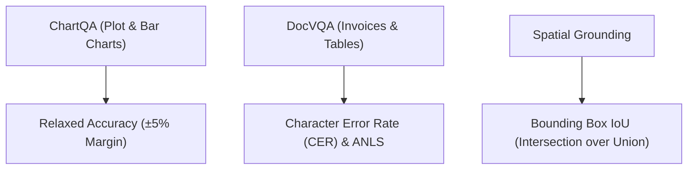

# multimodal-vision-bench

[](https://github.com/GuptaSoujanya/multimodal-vision-bench/actions)
[](https://opensource.org/licenses/MIT)
[](https://www.python.org/downloads/)

A standardized benchmarking framework for Vision-Language Models (VLMs) targeting OCR precision, dense document comprehension (DocVQA), plot/chart numerical reasoning (ChartQA), and 2D spatial grounding.

---

## Benchmark Comparisons (Frontier VLMs)

| Model Name | ChartQA (Relaxed ±5%) | DocVQA (ANLS) | InfoVQA | Spatial Grounding (IoU $\ge$ 0.5) |
| :--- | :--- | :--- | :--- | :--- |
| **GPT-4o (Vision)** | **85.7%** | **92.8%** | **78.4%** | **88.2%** |
| **Claude-3.5-Sonnet** | 84.8% | 93.1% | 77.2% | 86.5% |
| **Qwen-2-VL-72B-Instruct** | 83.2% | 91.5% | 75.8% | 85.1% |
| **Llama-3.2-11B-Vision-Instruct** | 74.5% | 84.2% | 66.8% | 76.4% |

---

## Evaluation Taxonomy



---

## Quickstart

```bash
git clone https://github.com/GuptaSoujanya/multimodal-vision-bench.git
cd multimodal-vision-bench
pip install -e .
python -m vision_bench.cli
```

---

## License

MIT License (c) 2024 Soujanya Gupta.

<!-- PR #5: docs: clarify benchmark metric configuration options -->
