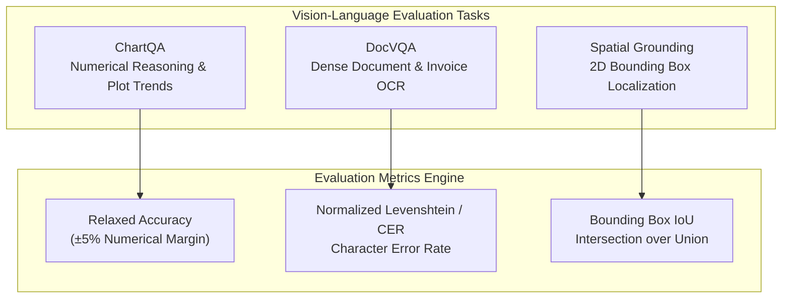

# multimodal-vision-bench

[](https://github.com/GuptaSoujanya/multimodal-vision-bench/actions)
[](https://opensource.org/licenses/MIT)
[](https://www.python.org/downloads/)

A standardized benchmarking framework for Vision-Language Models (VLMs) targeting OCR precision, document layout comprehension (DocVQA), chart reasoning (ChartQA), and 2D spatial grounding.

---

## Evaluation Taxonomy



---

## Benchmark Metrics

- **ChartQA Relaxed Accuracy:** Tolerates 5% numerical margin of error on plot and graph inquiries.
- **Document CER (Character Error Rate):** Normalized edit distance measuring OCR transcription degradation.
- **Spatial Bounding-Box IoU:** 2D polygon intersection over union for object localization.

---

## Installation

```bash
git clone https://github.com/GuptaSoujanya/multimodal-vision-bench.git
cd multimodal-vision-bench
pip install -e .
```

---

## Quickstart

```bash
python -m vision_bench.cli --tasks chartqa docvqa spatial
```

Sample Output:
```text
========================================================
           MULTIMODAL BENCHMARK RESULTS
========================================================
 Task: CHARTQA (Samples: 2)
   - Accuracy: 50.0%
--------------------------------------------------------
 Task: DOCVQA (Samples: 2)
   - Mean similarity: 74.5%
   - Mean cer: 0.255
--------------------------------------------------------
 Task: SPATIAL (Samples: 2)
   - Mean iou: 0.528
   - Iou success rate: 50.0%
--------------------------------------------------------
```

---

## Running Test Suite

```bash
python -m unittest discover tests -v
```

---

## License

This project is licensed under the MIT License - see the [LICENSE](LICENSE) file for details.
